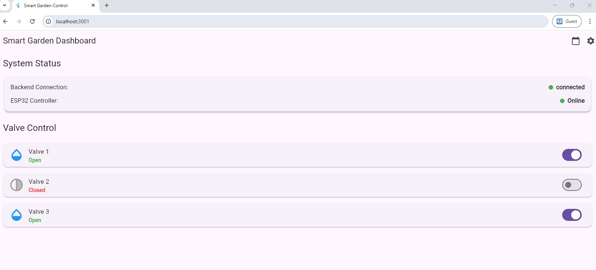
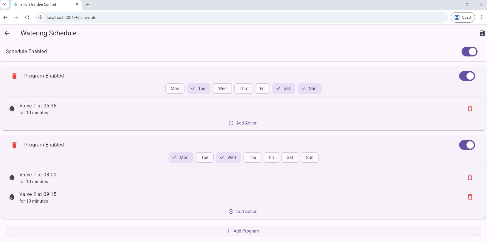

# Mobile Web App Detailed Design

## 1. Introduction

This document provides a detailed design for the mobile-friendly web application for the Smart Garden Watering System. The application is built using Flutter Web to ensure cross-platform compatibility and a native-like experience on mobile browsers. It serves as a convenient interface for users to monitor the status of their garden's watering system and manage irrigation schedules from any mobile device with a web browser.

## 2. Technology Stack

-   **Framework:** Flutter Web
-   **Programming Language:** Dart
-   **State Management:** Provider
-   **Communication:** WebSockets to the Node.js backend

## 3. Architecture

The mobile web app is a single-page application (SPA) that communicates with the existing backend server. It does not communicate directly with the MQTT broker.

```
+-------------------+             +-----------------------+
|                   |             |                       |
| Mobile Web App    | <---------> | Central Control Unit  |
| (Flutter)         |  (WebSocket)| (Raspberry Pi)        |
|                   |             | - MQTT Broker         |
+-------------------+             | - API/Web Server      |
                                  +-----------+-----------+
                                              |
                                              | MQTT
                                              |
                                  +-----------+-----------+
                                  |                       |
                                  | Combined Smart Water  |
                                  | Unit (ESP32)          |
                                  +-----------------------+
```

-   **Frontend:** The Flutter web app, responsible for the UI and user interaction.
-   **Backend:** The existing Node.js server, which relays messages between the web app and the MQTT broker.

## 4. UI/UX Design

The application will follow Material Design guidelines to provide a clean and intuitive user interface.

### 4.1. Screens

-   **Splash Screen:** A simple loading screen shown when the app is starting.
-   **Dashboard Screen:** The main screen of the app. It will display:
    -   The connection status to the backend.
    -   The online/offline status of the ESP32 controller.
    -   The current state of each valve (open/closed) with manual control buttons.
    
-   **Schedule Editor Screen:** A screen for viewing and editing the watering schedule. It will allow the user to:
    -   Enable or disable the entire schedule.
    -   Add, edit, or delete watering programs.
    -   Define the days, start time, and duration for each watering action.
    

## 5. Communication

The app will use a WebSocket connection to the backend for real-time, bidirectional communication.

-   **Outgoing Messages:** When the user performs an action (e.g., toggles a valve, saves a schedule), the app sends a JSON message to the backend via the WebSocket.
-   **Incoming Messages:** The app listens for messages from the backend to update the UI with the latest status of the controller and valves.

## 6. State Management

The Provider package will be used for state management to separate the UI from the business logic.

-   **`AppState`:** A central model to hold the application's state, such as the connection status, controller status, valve states, and the watering schedule.
-   **`ChangeNotifierProvider`:** Used to provide the `AppState` to the widget tree. Widgets will listen for changes in the state and rebuild accordingly.

## 7. Operation

To use the mobile web application, follow these steps:

1.  **Ensure Backend is Running:** Make sure your Node.js backend server is running. This server is responsible for serving the web application files and acting as the WebSocket bridge to your MQTT broker.
2.  **Access the Application:** Open a web browser on your mobile device (or computer) and navigate to the IP address and port where your backend server is hosted. For example, if your Raspberry Pi's IP address is `192.168.1.100` and the backend is running on port `3001`, you would go to `http://192.168.1.100:3001`.
3.  **Dashboard:** Upon loading, you will see the Dashboard screen, which provides an overview of your system's status, including backend connection, ESP32 controller status, and the current state of each valve. You can toggle valves directly from this screen.
4.  **Settings:** Tap the settings icon (gear) in the app bar to configure the WebSocket URL if your backend is not at the default `ws://localhost:3001`. After changing the URL, tap "Save and Reconnect".
5.  **Schedule Editor:** Tap the calendar icon in the app bar to navigate to the Schedule Editor. Here you can:
    -   Toggle the overall schedule enabled/disabled.
    -   Add new watering programs.
    -   Edit existing programs by enabling/disabling them, selecting specific days of the week, and adding/editing/deleting watering actions.
    -   For each watering action, you can set the target valve, start time, and duration.
    -   Tap the "Save" icon in the app bar to send your updated schedule to the ESP32 controller.
